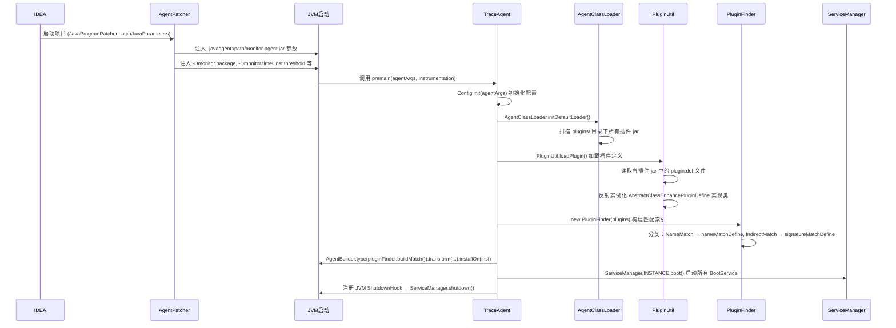
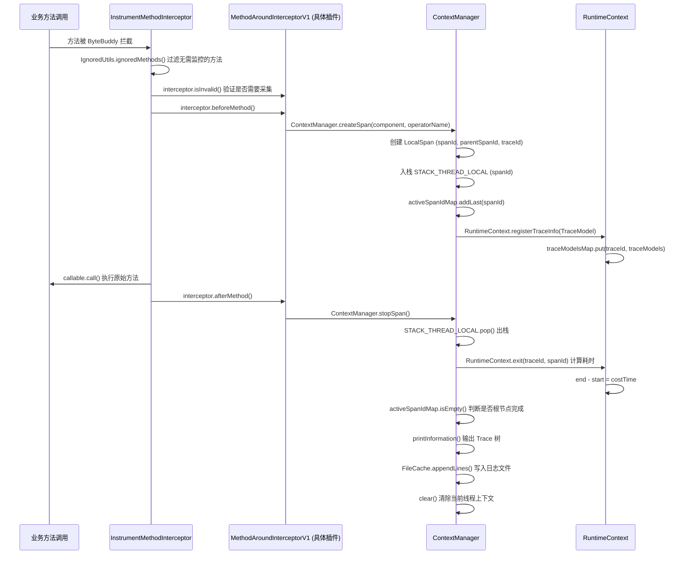
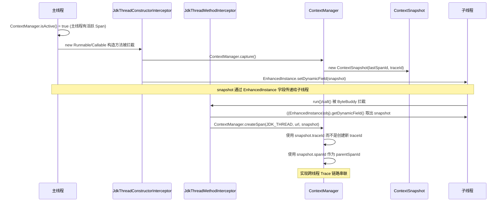
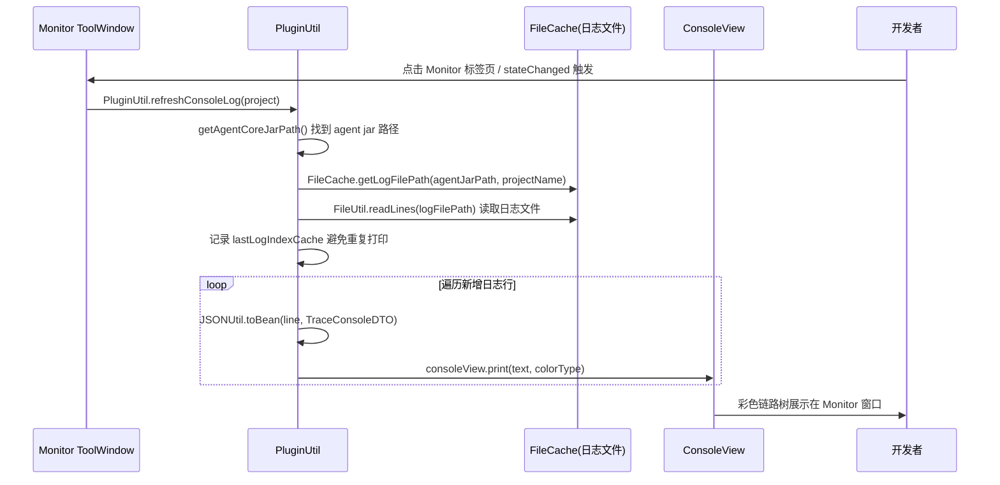
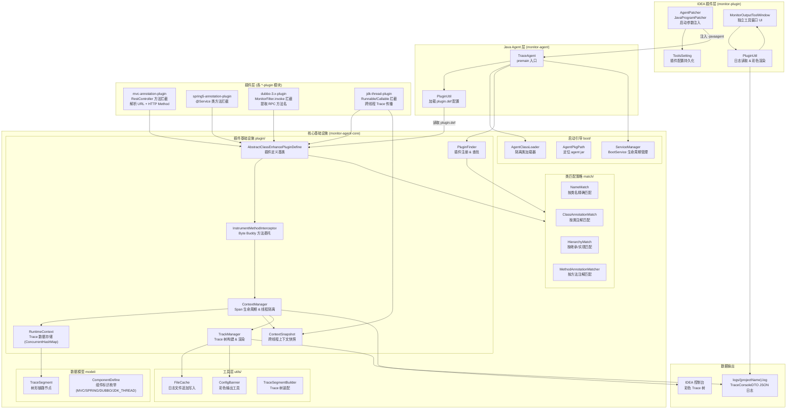
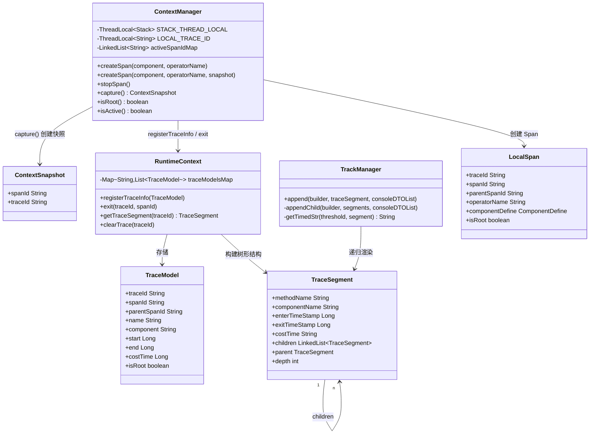

# Service Invocation Monitor — 全面技术分析报告

> 版本：V20240228 | 分析日期：2026-10-16 | 作者：小白菜 (caijianying)

---

## 目录

1. [项目概述](#1-项目概述)
2. [主要技术栈与实现原理](#2-主要技术栈与实现原理)
3. [模块结构](#3-模块结构)
4. [核心流程梳理](#4-核心流程梳理)
5. [项目架构图](#5-项目架构图)
6. [核心关系图](#6-核心关系图)
7. [各模块详细分析](#7-各模块详细分析)
8. [配置参数说明](#8-配置参数说明)
9. [总结与设计亮点](#9-总结与设计亮点)

---

## 1. 项目概述

**Service Invocation Monitor** 是一款基于 **SkyWalking** 设计思路、面向 IntelliJ IDEA 的轻量级 **0侵入式链路监控插件**。

| 属性 | 说明 |
|------|------|
| 目标 | 在开发阶段监控 SpringBoot 应用的调用链，统计方法耗时 |
| 接入方式 | 0 侵入，无需修改业务代码 |
| 触发时机 | 在 IDEA 中启动项目时自动挂载 |
| 展示方式 | IDEA 控制台彩色输出 + Monitor 独立工具窗口 |

**支持的监控范围：**
- Spring MVC 注解（`@GetMapping` / `@PostMapping` / `@PutMapping` / `@DeleteMapping` / `@PatchMapping`）
- Spring 服务层注解（`@Service`）
- Dubbo 3.x RPC 调用链
- 跨线程调用追踪（支持 `Runnable` / `Callable`）

---

## 2. 主要技术栈与实现原理

### 2.1 核心技术

| 技术 | 版本 | 用途 |
|------|------|------|
| **Java Agent** (Instrumentation API) | JDK 8 | JVM 级字节码植入入口 |
| **Byte Buddy** | 1.12.6 | 字节码增强、方法拦截 |
| **IntelliJ Platform Plugin SDK** | - | IDEA 插件开发 |
| **SkyWalking 设计理念** | 参考 | Trace/Span 模型设计 |
| **Hutool** | 5.8.5 | 工具类（文件、JSON、UUID 等） |
| **Lombok** | 1.18.2 | 减少样板代码 |
| **SLF4J** | 1.7.36 | 日志接口 |
| **Guava** | 31.0.1 | 集合工具 |
| **Gradle** | - | 多模块构建工具 |

### 2.2 实现原理总览

整个系统由两条核心技术链支撑：

```
┌─────────────────────────────────────────────────────────────────┐
│  链路一：Java Agent + Byte Buddy 字节码插桩                       │
│                                                                  │
│  JVM 启动时 → premain() → Byte Buddy AgentBuilder →             │
│  拦截匹配的类/方法 → 织入 Before/After 回调 →                    │
│  收集 Span 信息 → 写入 TraceSegment 树                           │
└─────────────────────────────────────────────────────────────────┘
                         ↕ 文件 I/O
┌─────────────────────────────────────────────────────────────────┐
│  链路二：IDEA Plugin 展示层                                      │
│                                                                  │
│  AgentPatcher（JavaProgramPatcher） →                            │
│  启动时自动注入 -javaagent 参数 →                                │
│  Monitor ToolWindow 读取日志文件 →                               │
│  彩色渲染 Trace 树到控制台                                       │
└─────────────────────────────────────────────────────────────────┘
```

### 2.3 Java Agent Attach 机制

```
应用启动命令行：
  java -javaagent:/path/to/monitor-agent.jar -jar app.jar

JVM 加载顺序：
  1. 解析 Manifest.mf 中的 Premain-Class
  2. 调用 TraceAgent.premain(agentArgs, Instrumentation inst)
  3. 注册 Byte Buddy Transformer
  4. 后续所有类加载都经过 Transformer 检查并按需增强
```

### 2.4 Byte Buddy 字节码增强原理

Byte Buddy 提供了声明式的字节码增强 API，核心是 `AgentBuilder`：

```java
// TraceAgent.java 核心逻辑
new AgentBuilder.Default()
    .ignore(/* 排除框架类、JDK内部类等 */)
    .type(pluginFinder.buildMatch())       // 匹配需要增强的类
    .transform((builder, type, classLoader, module) -> {
        // 找到匹配该类的所有插件
        List<AbstractClassEnhancePluginDefine> plugins = pluginFinder.find(type);
        for (AbstractClassEnhancePluginDefine plugin : plugins) {
            builder = plugin.enhance(builder, type, classLoader);
        }
        return builder;
    })
    .installOn(inst);
```

增强的三种方式：
1. **字段注入**：向被增强类注入 `_$EnhancedClassField_ws` 字段，实现 `EnhancedInstance` 接口，用于跨线程上下文传播
2. **构造方法拦截**：`SuperMethodCall + MethodDelegation` 在构造后植入逻辑
3. **实例方法拦截**：`MethodDelegation` 委托到 `InstrumentMethodInterceptor`，实现 Before/After 回调

### 2.5 现代化工程多模块构建与集中式产物收敛体系 (Gradle 9.x)

为彻底解决传统 Gradle 多模块工程中 `build/` 文件夹散落在各子模块源码目录的杂乱现状，构建体系进行了现代化升级：
1. **集中式构建目录 (`layout.buildDirectory`)**：在根工程 `allprojects` 中通过 Gradle 9 官方 API 将所有子模块输出统一收拢至最外层 `build/` 目录下，并按照架构层级自动分类：
   - `build/agent/`：收拢探针核心 Jar 与中间产物；
   - `build/plugins/`：收拢字节码插桩子插件 Jar；
   - `build/monitor-plugin/`：收拢 IDEA 插件沙箱、distributions 等；
   - `build/root/`：根工程检查报告与临时任务。
2. **全自动集成打包与分发归档**：
   - `monitor-plugin` 的 `PrepareSandboxTask` 自动挂载依赖探针 ShadowJar 与子插件 Jar，并最终打包输出至根工程 `dist/` 目录。
   - 根工程统一增强 `clean` 任务，实现对根目录集中 `build/` 的彻底与安全清理。

---

## 3. 模块结构

```
Service-invocation-monitor/
├── build/                          # 【集中收拢构建产物】全工程构建输出统一归集于根目录，按层级分类
│   ├── agent/                      # 探针核心层编译输出 (monitor-agent, monitor-agent-core)
│   ├── plugins/                    # 字节码增强插桩插件编译输出 (dubbo, jdk-thread, mvc, spring5)
│   ├── monitor-plugin/             # IDEA 插件主工程产物 (sandbox, distributions, classes)
│   └── root/                       # 根工程检查报告与临时任务
├── dist/                           # 【最终交付目录】一键打包生成的 IDEA 插件安装包 (.zip)
├── monitor-agent/                  # JavaAgent 主入口 + 线程插件内嵌
│   └── TraceAgent.java             # premain 入口
├── monitor-agent-core/             # 核心基础设施（框架层）
│   ├── boot/                       # 启动引导（ServiceManager、AgentPkgPath）
│   ├── config/                     # 配置读取（Config）
│   ├── plugin/                     # 插件核心抽象
│   │   ├── AbstractClassEnhancePluginDefine  # 插件定义基类
│   │   ├── PluginFinder            # 插件查找器
│   │   ├── context/                # 上下文管理（ContextManager、RuntimeContext）
│   │   ├── interceptor/            # 拦截器抽象
│   │   ├── loader/                 # AgentClassLoader（插件类隔离）
│   │   └── match/                  # 类匹配策略
│   ├── model/                      # 数据模型（TraceSegment）
│   ├── trace/                      # 组件标识枚举（ComponentDefine）
│   └── utils/                      # 工具类
├── mvc-annotation-plugin/          # Spring MVC 插件
├── spring5-annotation-plugin/      # Spring @Service 插件
├── dubbo-3.x-plugin/               # Dubbo RPC 插件
├── jdk-thread-plugin/              # 跨线程追踪插件
├── monitor-plugin/                 # IDEA 插件（展示层）
│   ├── patcher/AgentPatcher        # 启动参数注入
│   ├── ui/MonitorOutputToolWindow  # 独立工具窗口
│   ├── filter/ConsoleFilter        # 控制台过滤器
│   └── utils/PluginUtil            # 日志读取 & 渲染
└── monitor-agent-test/             # 单元测试
```

---

## 4. 核心流程梳理

### 4.1 整体启动流程



### 4.2 方法调用链路采集流程



### 4.3 跨线程 Trace 传播流程



### 4.4 IDEA 插件读取展示流程



---

## 5. 项目架构图



---

## 6. 核心关系图

### 6.1 插件扩展点关系

```mermaid
classDiagram
    class AbstractClassEnhancePluginDefine {
        +enhanceClass() ClassMatch
        +getInstanceMethodsInterceptPoints() InstanceMethodsInterceptPoint[]
        +getConstructorsInterceptPoints() ConstructorInterceptPoint[]
        +useEnhancedInstance() boolean
        +enhance(builder, typeDescription, classLoader) DynamicType.Builder
    }

    class RestControllerInstrumentation {
        +enhanceClass() ClassAnnotationMatch(@RestController)
        +getInstanceMethodsInterceptPoints() MvcAnnotationInterceptor
    }

    class ServiceInstrumentation {
        +enhanceClass() ClassAnnotationMatch(@Service)
        +getInstanceMethodsInterceptPoints() SpringAnnotationInterceptor
    }

    class ApacheDubboInstrumentation {
        +enhanceClass() NameMatch(MonitorFilter)
        +getInstanceMethodsInterceptPoints() DubboInterceptor, invoke方法
    }

    class RunnableInstrumentation {
        +enhanceClass() HierarchyMatch(Runnable)
        +getInstanceMethodsInterceptPoints() JdkThreadMethodInterceptor, run方法
        +getConstructorsInterceptPoints() JdkThreadConstructorInterceptor
        +useEnhancedInstance() true
    }

    class CallableInstrumentation {
        +enhanceClass() HierarchyMatch(Callable)
        +getInstanceMethodsInterceptPoints() JdkThreadMethodInterceptor, call方法
        +getConstructorsInterceptPoints() JdkThreadConstructorInterceptor
        +useEnhancedInstance() true
    }

    AbstractClassEnhancePluginDefine <|-- RestControllerInstrumentation
    AbstractClassEnhancePluginDefine <|-- ServiceInstrumentation
    AbstractClassEnhancePluginDefine <|-- ApacheDubboInstrumentation
    AbstractClassEnhancePluginDefine <|-- RunnableInstrumentation
    AbstractClassEnhancePluginDefine <|-- CallableInstrumentation

    class MethodAroundInterceptorV1 {
        <<interface>>
        +beforeMethod(obj, clazz, method, args, types)
        +afterMethod(obj, clazz, method, args, types)
        +isInvalid(obj, clazz, method, args, types) boolean
    }

    class MvcAnnotationInterceptor {
        +beforeMethod() ContextManager.createSpan(MVC, url)
        +afterMethod() ContextManager.stopSpan()
    }

    class SpringAnnotationInterceptor {
        +beforeMethod() ContextManager.createSpan(SPRING, method)
        +afterMethod() ContextManager.stopSpan()
    }

    class DubboInterceptor {
        +beforeMethod() ContextManager.createSpan(DUBBO, rpcName)
        +afterMethod() ContextManager.stopSpan()
    }

    class JdkThreadMethodInterceptor {
        +beforeMethod() ContextManager.createSpan(JDK_THREAD, url, snapshot)
        +afterMethod() ContextManager.stopSpan()
    }

    MethodAroundInterceptorV1 <|.. MvcAnnotationInterceptor
    MethodAroundInterceptorV1 <|.. SpringAnnotationInterceptor
    MethodAroundInterceptorV1 <|.. DubboInterceptor
    MethodAroundInterceptorV1 <|.. JdkThreadMethodInterceptor
```



### 6.2 上下文与 Trace 模型关系



### 6.3 类加载器隔离关系

```mermaid
graph LR
    subgraph SystemClassLoader["系统类加载器"]
        App["应用业务代码"]
        Core["monitor-agent-core (核心框架)"]
        TraceAgent["TraceAgent.class"]
    end

    subgraph AgentClassLoader["AgentClassLoader (自定义)"]
        MVC_JAR["mvc-annotation-plugin.jar"]
        SPRING_JAR["spring5-annotation-plugin.jar"]
        DUBBO_JAR["dubbo-3.x-plugin.jar"]
        THREAD_JAR["jdk-thread-plugin.jar"]
    end

    subgraph PluginDir["plugins/ 目录"]
        MVC_FILE["mvc-annotation-plugin-xxx.jar"]
        SPRING_FILE["spring5-annotation-plugin-xxx.jar"]
        DUBBO_FILE["dubbo-3.x-plugin-xxx.jar"]
        THREAD_FILE["jdk-thread-plugin-xxx.jar"]
    end

    AgentClassLoader -->|parent| SystemClassLoader
    AgentClassLoader -->|扫描加载| PluginDir
    MVC_FILE --> MVC_JAR
    SPRING_FILE --> SPRING_JAR
    DUBBO_FILE --> DUBBO_JAR
    THREAD_FILE --> THREAD_JAR

    TraceAgent -->|getDefault()| AgentClassLoader
    Core -->|InterceptorInstanceLoader.load()| AgentClassLoader
```

---

## 7. 各模块详细分析

### 7.1 monitor-agent-core（核心框架层）

这是整个项目的基础设施层，提供框架抽象，业务插件不依赖具体实现。

#### 关键类分析

| 类名 | 职责 | 核心设计 |
|------|------|----------|
| `AgentClassLoader` | 自定义类加载器，从 `plugins/` 目录加载插件 jar | 注册为并行能力（`registerAsParallelCapable`）防止死锁；懒加载 + 重入锁扫描 jar |
| `ServiceManager` | 单例枚举，管理 `BootService` 生命周期 | 使用 `ServiceLoader.load(BootService.class, AgentClassLoader)` SPI 机制加载服务 |
| `ContextManager` | 链路上下文管理（implements BootService） | `ThreadLocal<Stack>` 存储 Span 栈；`LinkedList` 追踪活跃 span；`activeSpanIdMap.isEmpty()` 判断链路结束时机 |
| `RuntimeContext` | Trace 数据中心 | `ConcurrentHashMap<traceId, List<TraceModel>>` 全局存储；提供树形结构构建 |
| `PluginFinder` | 插件注册 & 类匹配 | 分两路：`nameMatchDefine`（HashMap精确匹配）和 `signatureMatchDefine`（注解/继承模糊匹配）|
| `AbstractClassEnhancePluginDefine` | 插件定义模板 | 模板方法模式：子类声明 `enhanceClass()` 和 `getInstanceMethodsInterceptPoints()`，基类统一执行 Byte Buddy 增强 |
| `AgentPkgPath` | 定位 agent jar 所在目录 | 通过分析类文件 URL（`jar:file:/path/monitor-agent.jar!/...`）反推 jar 目录 |

#### 类匹配策略

| 匹配类型 | 实现类 | 应用场景 |
|----------|--------|----------|
| 精确类名匹配 | `NameMatch` | Dubbo MonitorFilter |
| 类注解匹配 | `ClassAnnotationMatch` | `@RestController`, `@Service` |
| 继承/实现匹配 | `HierarchyMatch` | `Runnable`, `Callable` |
| 方法注解匹配 | `MethodAnnotationMatcher` | 扩展用，目前未直接使用 |

### 7.2 mvc-annotation-plugin（Spring MVC 插件）

- **增强目标**：所有带 `@RestController` 注解的类的全部公开实例方法
- **核心逻辑**：`MvcAnnotationInterceptor`
  - `isRoot()` 为 true 时（入口调用），尝试解析 HTTP URL 路径作为 Span 名称
  - 支持 `@GetMapping/@PostMapping/@PutMapping/@DeleteMapping/@PatchMapping` 注解解析
  - `ParsePathUtil.recursiveParseMethodAnnotation()` 支持方法注解继承解析
- **Span 名称格式**：`GET /api/user/list` 或 `com.example.UserController.getUser`

### 7.3 spring5-annotation-plugin（Spring Service 插件）

- **增强目标**：所有带 `@Service` 注解的类的全部公开实例方法
- **Span 名称格式**：`com.example.UserServiceImpl.getUser`
- **特点**：与 MVC 插件协同工作，MVC 拦截入口，Spring 拦截内层服务调用

### 7.4 dubbo-3.x-plugin（Dubbo RPC 插件）

- **增强目标**：`org.apache.dubbo.monitor.support.MonitorFilter` 的 `invoke` 方法
- **特点**：利用 Dubbo 本身的 Filter 机制切入，无需关心 Provider/Consumer 区分逻辑
- **Span 名称格式**：`group/com.example.UserService.getUser(String,Long)`
- **元数据提取**：从 `Invoker.getUrl()` 和 `Invocation` 中提取接口名、方法名、参数类型

### 7.5 jdk-thread-plugin（跨线程追踪插件）

这是最复杂的插件，解决了异步线程 Trace 断裂问题：

**关键设计：EnhancedInstance 字段注入**

```
主线程创建 Runnable 对象时：
  → 构造方法被拦截（JdkThreadConstructorInterceptor）
  → 如果当前有活跃 Span，capture() 生成 ContextSnapshot
  → ContextSnapshot 存入 Runnable 对象的增强字段 _$EnhancedClassField_ws

子线程执行 run() 时：
  → run() 方法被拦截（JdkThreadMethodInterceptor）
  → 从增强字段取出 ContextSnapshot
  → createSpan(JDK_THREAD, url, snapshot) 使用 snapshot 中的 traceId 和 parentSpanId
  → 实现跨线程 Span 关联
```

### 7.6 monitor-plugin（IDEA 插件层）

| 类名 | 职责 |
|------|------|
| `AgentPatcher` | 实现 `JavaProgramPatcher`，在项目启动时自动注入 `-javaagent` 及所有 `-D` 参数 |
| `MonitorOutputToolWindow` | IDEA 独立 Monitor 窗口工厂，管理 `ConsoleView` 实例（按 Project 隔离） |
| `ToolsSetting` | IntelliJ 持久化插件配置（耗时阀值、采样率），通过 IDEA 设置界面配置 |
| `PluginUtil` | 读取日志文件，用增量索引（`lastLogIndexCache`）避免重复渲染；按颜色标识渲染 |
| `MonitorOutPutToolWindowListener` | 监听 Monitor 窗口激活事件，激活时触发日志刷新 |
| `UseSystemActionListener` | 监听用户操作事件 |

---

## 8. 配置参数说明

| 参数 | 类型 | 默认值 | 说明 |
|------|------|--------|------|
| `monitor.package` | `-Dmonitor.package` | 启动类所在包 | 限制监控范围的包名，避免拦截过多无关类 |
| `monitor.timeCost.threshold` | `-Dmonitor.timeCost.threshold` | `100` (ms) | 高耗时判断阈值，超过则红色高亮 |
| `monitor.sampleRate` | `-Dmonitor.sampleRate` | `10000` (100%) | 采样率，精度 1/10000，控制日志写入量 |
| `monitor.agent.path` | `-Dmonitor.agent.path` | (由插件自动注入) | agent jar 的绝对路径，用于定位日志目录 |
| `monitor.project.code` | `-Dmonitor.project.code` | (由插件自动注入) | 项目标识名，对应日志文件名 `{projectName}.log` |

**日志文件位置**：`{agentJarParentDir}/../logs/{projectName}.log`

---

## 9. 总结与设计亮点

### 设计亮点

1. **完全 0 侵入**：通过 IDEA 插件自动注入 `-javaagent` 参数，开发者无需修改任何代码或配置
2. **SkyWalking 插件化设计**：`AbstractClassEnhancePluginDefine` 模板方法 + `plugin.def` SPI 文件，新增框架支持只需新增插件模块
3. **类加载隔离**：`AgentClassLoader` 专门加载插件类，避免与应用类路径冲突，父委托模型保证 core 类共享
4. **跨线程 Trace 传播**：利用 Byte Buddy 字段注入 + `ContextSnapshot` 实现无侵入的异步 Trace 继承
5. **高性能 Span 管理**：使用 `ThreadLocal<Stack>` 做无锁线程内 Span 栈管理；`ConcurrentHashMap` 支持多线程并发 Trace 存储
6. **彩色视觉输出**：调用链以树状结构输出，高耗时节点红色高亮，利用 ANSI 转义码和 IDEA ConsoleViewContentType 实现双端渲染

### 当前限制

- 跨线程追踪仅支持标准 `Runnable`/`Callable` 接口实现类；不支持 CompletableFuture、响应式编程等更复杂模式
- `ThreadInterceptor` 和 `ThreadConstructorInterceptor`（直接 Thread 拦截方式）代码目前已注释，表明跨线程追踪仍在迭代
- 采样率实现逻辑（`consoleDTOList.size() <= sampleRate`）略为简化，实际是按调用深度控制写入，并非随机采样

### 数据流总结

```
业务代码调用
  → ByteBuddy 拦截
    → InstrumentMethodInterceptor (before)
      → MethodAroundInterceptorV1.beforeMethod
        → ContextManager.createSpan
          → RuntimeContext.registerTraceInfo (内存 TraceModel 存储)
  → 原始方法执行
  → InstrumentMethodInterceptor (after)
    → MethodAroundInterceptorV1.afterMethod
      → ContextManager.stopSpan
        → RuntimeContext.exit (计算耗时)
        → [链路完成] → TrackManager.append (渲染 Trace 树)
          → System.out.println (IDEA 控制台彩色输出)
          → FileCache.appendLines (写入 JSON 日志文件)
            → [IDEA Monitor 窗口] PluginUtil.refreshConsoleLog
              → ConsoleView.print (独立窗口彩色展示)
```
